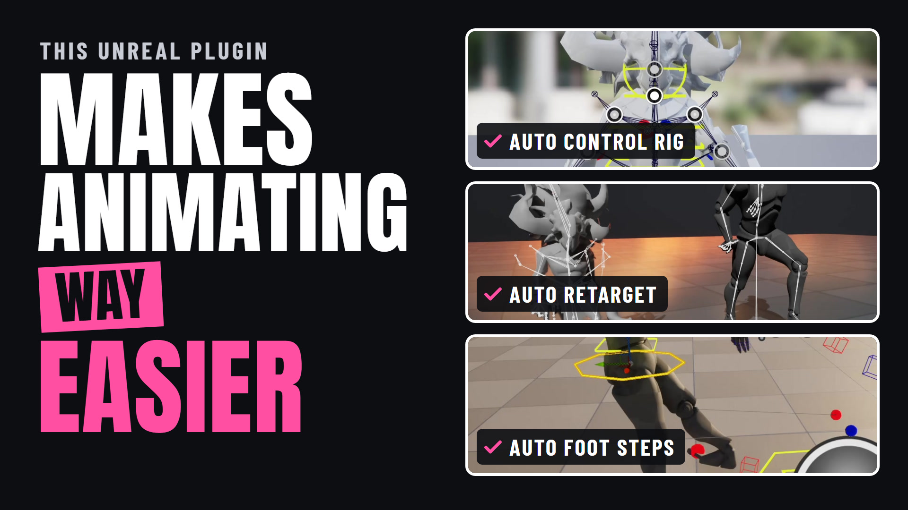
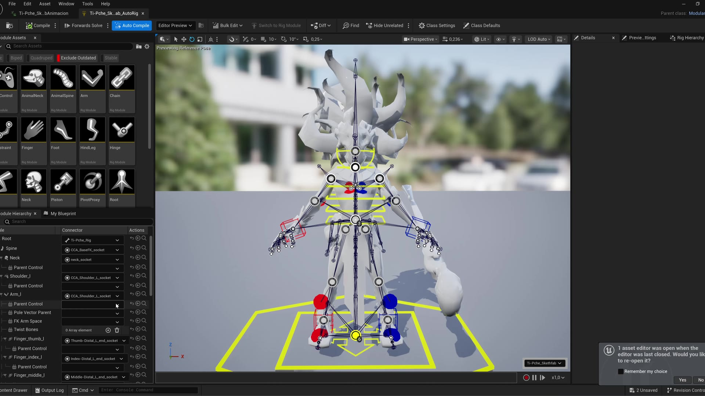
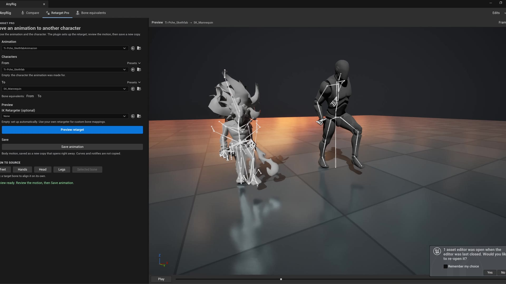
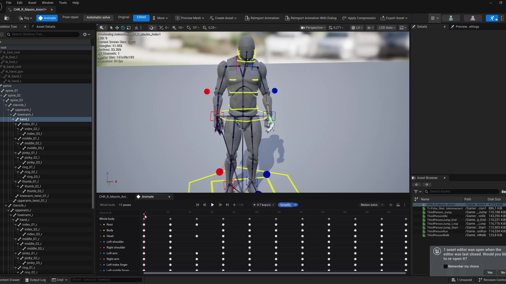
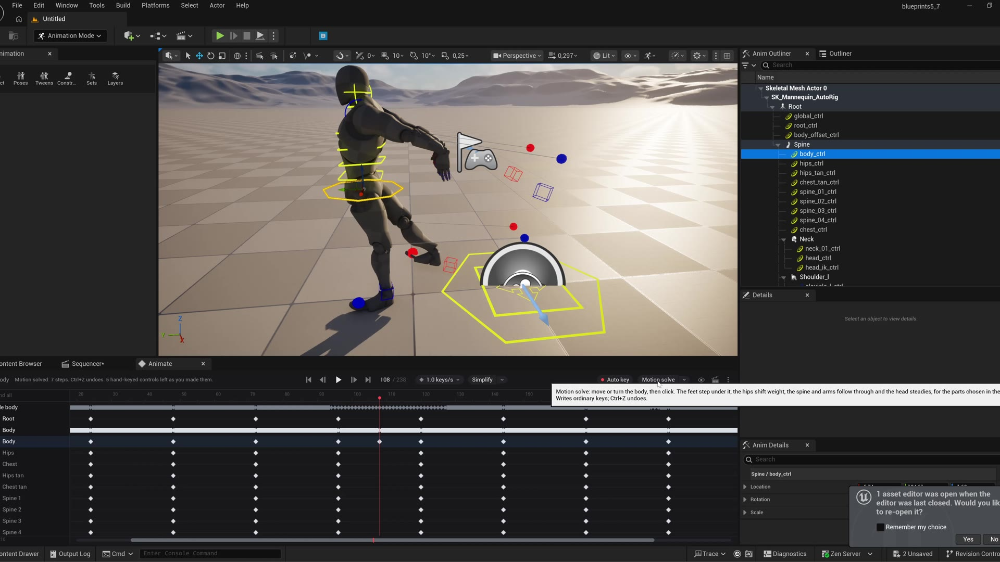

<h1 align="center">AnyRig</h1>

<b>Edit, rig and retarget any character with Control Rig in Unreal Engine.</b> 
Unreal Engine 5.3 – 5.8 · Editor plugin · Windows

<a href="AnyRig-Documentation.pdf"><b>📄 Full documentation (PDF)</b></a> ·
<a href="[FAB LINK]"><b>Get it on Fab</b></a> ·
<a href="[YOUTUBE LINK]"><b>Video tutorial</b></a> ·
<a href="../../issues"><b>Support</b></a>

---

## What it does

| | |
|---|---|
| **Animate** | Edit any Animation Sequence with Control Rig, right in the animation editor. Work with 1 key per second instead of 30, Simplify the take, Smooth mocap glitches, and open it in Sequencer in one click. |
| **Motion Solve** | Move the body; AnyRig adds foot steps, hip dip, chest lean and head follow-through. Your own keys are kept. |
| **Automatic Rig** *(UE 5.4+)* | A complete Control Rig (spine, neck, arms, legs, fingers, IK/FK, poles) for a character with any skeleton, built with Epic's Modular Rig. |
| **Retarget Pro** | Move animations between different skeletons, even made-up ones, with the IK Rigs and Retargeter set up for you. |
| **Bone recognition** | Unreal, MetaHuman, Mixamo, DAZ, Character Creator, Biped, Unity/VRM, Maya, Rigify and MMD names, in 8 languages, with typos, or from the skeleton's shape. |
| **Compare · Animation Scaled · Bone equivalents** | See why two skeletons don't share animations, fix retargeting options in one click, and correct any bone match. |

 

 

## Installation

1. Copy the `CharacterCompatibilityAnalyzer` folder for **your engine version** into `YourProject/Plugins/`.
2. Open the project (precompiled, no Visual Studio needed; Blueprint-only projects work).
3. Open **Window › AnyRig**, or open any Animation Sequence.

Requires Epic's **Control Rig**, **IK Rig** and **Sequencer Scripting** plugins (bundled with the engine), and **Control Rig Modules** for Automatic Rig.

## Engine versions

| Feature | 5.3 | 5.4 | 5.5 | 5.6 | 5.7 | 5.8 |
|---|:-:|:-:|:-:|:-:|:-:|:-:|
| Animate, Simplify, Smooth, Motion Solve | ✓ | ✓ | ✓ | ✓ | ✓ | ✓ |
| **Automatic Rig** | — | ✓ | ✓ | ✓ | ✓ | ✓ |
| Retarget Pro, Bone equivalents, Compare | ✓ | ✓ | ✓ | ✓ | ✓ | ✓ |
| Bone recognition | ✓ | ✓ | ✓ | ✓ | ✓ | ✓ |

Small behaviour differences between versions (Sequencer muting, interpolation, the retargeting engine and more) are listed in **section 3 of the [documentation](AnyRig-Documentation.pdf)**.

## Support

Open an [issue](../../issues) with your engine version, a screenshot of the character's bone tree and the Output Log.

---
AnyRig never renames or overwrites your original skeletons, meshes or animations.
